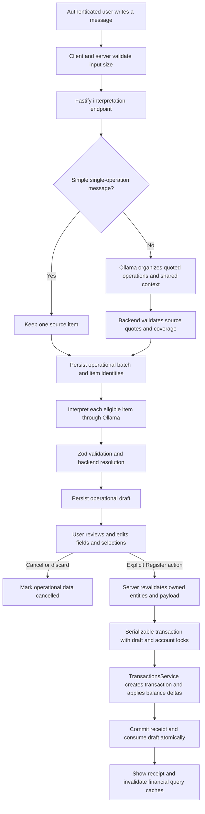

# Local AI transaction architecture

This document describes the implemented experiment. For installation, configuration, manual
checks and troubleshooting, use [the experiment guide](ollama-experiment.md). For measured
model behavior, use [the evaluation notes](ollama-evaluation.md).

## End-to-end flow

The diagram follows the chat request with a client `requestId`; the legacy single endpoint
without that identity is described in the API table below.

There is no frontend-to-Ollama connection. The model has no database client, SQL execution,
financial mutation tools or confirmation capability. Organization, extraction and draft
creation only write operational metadata. Financial persistence begins at confirmation.

The integration uses native backend `fetch`, not Vercel AI SDK. A small provider interface
isolates the Ollama transport and permits simulated responses in tests. The experiment needs
bounded structured responses from one local provider; an additional orchestration SDK is not
part of this implementation. Model names remain configuration rather than business rules.

The single-operation shortcut is conservative; it is not a user input format requirement.
Other messages go through organization, including prose and nested date/category/account
groups. One recognized operation keeps the individual review form; several open the collection
review. Shared context never overrides an explicit local value. Missing and ambiguous fields
are resolved by selectors or form controls before registration.

## Frontend responsibilities

Source paths below are relative to `apps/frontend/src/`.

| Component or module                                           | Responsibility                                                                                                                                |
| ------------------------------------------------------------- | --------------------------------------------------------------------------------------------------------------------------------------------- |
| `features/ai-transactions/components/AiTransactionChat.tsx`   | Drawer, writing area, capabilities and character limit, initial interpretation, single/collection presentation, focus and scrolling behavior. |
| `features/ai-transactions/components/WaitingMessage.tsx`      | Neutral loading feedback and an additional waiting notice after 75 seconds; no invented model stages.                                         |
| `features/ai-transactions/components/BatchReview.tsx`         | Visual grouping, real preparation counts, selection, one expanded record, sequential registration and per-record recovery.                    |
| `features/ai-transactions/components/TransactionProposal.tsx` | Editable single-record review, validation and confirmation/cancellation actions.                                                              |
| `features/transactions/components/TransactionFields.tsx`      | Shared fields and form schema reused by manual and AI transaction entry.                                                                      |
| `features/ai-transactions/components/SourceMessage.tsx`       | Original text and inherited context displayed as quotations, with accessible native disclosure controls.                                      |
| `features/ai-transactions/actions.ts`                         | Shared preparation and registration actions; frozen confirmation payloads and query-cache invalidation.                                       |
| `features/ai-transactions/store.ts`                           | In-memory chat entries, input, selection, edits, receipts and recovery state.                                                                 |
| `features/ai-transactions/session.ts`                         | Versioned Zod-validated, user-scoped `sessionStorage` serialization and hydration.                                                            |
| `features/ai-transactions/api.ts`                             | Authenticated backend requests; no model URL, model credentials or direct provider access.                                                    |

React state describes the workflow, not the truth of financial persistence. Entries use
`queued`, `interpreting`, `pending`, `confirmed`, `cancelled` and `error`. A pending entry can
also carry a confirmation marked `saving` or `uncertain`.

Before a confirmation request, the store saves the exact submitted fields and draft identity.
When the response is lost, the client cannot know whether the server committed: keep the
entry uncertain and retry that same draft/payload explicitly. Never reinterpret the message
as a save retry. Successful receipts remain successful even if refreshing a query cache fails.

The individual form and collection use the same registration action. Collection approval
saves selected records sequentially in source order, independent of visual grouping. It is
not an all-or-nothing batch transaction. An uncertain save stops the queue. Pausing stops
future requests; it does not roll back already registered transactions.

Only the history scrolls in the drawer; header and footer stay accessible. Automatic scrolling
respects users reading older entries. Source text is separate from editable financial fields.
Selection controls and the attention filter disappear when no unresolved entries remain.
The input counter reflects the server's configured limit and retains oversized pasted text
for editing instead of silently cutting it. Theme and copy use Mantine and existing i18n.

### Recovery after reload

The tab-scoped snapshot preserves unsent text, edits, batch metadata, selection, receipts and
uncertain confirmation payloads after authentication verifies the owner. Logout or a user
change clears it. No authentication credentials are stored with chat data.

- In-flight interpretation becomes interrupted, with explicit retry/edit actions.
- In-flight saving becomes uncertain and retains the exact payload.
- Queued batch items require explicit preparation resumption.
- Hydration never automatically interprets, saves or cancels.
- Blocked/full storage falls back to memory with visible feedback.

Server operational metadata is distinct from this browser snapshot: losing a tab is not a
database cleanup operation. Expired drafts and batches are not automatically deleted, and
these metadata are excluded from financial exports. See the guide for retention and expiry.

## Backend responsibilities

Source paths below are relative to `apps/backend/src/`.

| Module                                                                                                          | Responsibility                                                                                                   |
| --------------------------------------------------------------------------------------------------------------- | ---------------------------------------------------------------------------------------------------------------- |
| `modules/ai-transactions/routes.ts`                                                                             | Authentication, feature availability, input/rate limits, request cancellation and provider/service wiring.       |
| `modules/ai-transactions/model-session.ts`                                                                      | Startup preload, retry and unload lifecycle; residency is independent of browser focus.                          |
| `modules/ai-transactions/ollama-provider.ts`                                                                    | Native HTTP adapter, local-only configuration checks, model controls, timeouts and strict response validation.   |
| `modules/ai-transactions/provider.ts`                                                                           | Provider abstraction, extraction and organization prompt versions and interpretation context contract.           |
| `modules/ai-transactions/organization.ts`                                                                       | Conservative single shortcut, quote validation, source coverage and scoped context.                              |
| `modules/ai-transactions/batches-service.ts`                                                                    | Durable batches/items, idempotent preparation, ownership and per-item cancellation.                              |
| `modules/ai-transactions/batch-resolution.ts`                                                                   | Shared context resolution, explicit local overrides and ambiguous fields.                                        |
| `modules/ai-transactions/resolution.ts`, `modules/ai-transactions/dates.ts`, `modules/ai-transactions/money.ts` | Owned-name matching, supported intent guards, deterministic calendar resolution and integer COP-cent conversion. |
| `modules/ai-transactions/service.ts`                                                                            | Legacy single drafts, strict confirmation validation, durable replay and atomic financial registration.          |
| `modules/transactions/service.ts`                                                                               | Existing financial business rules, account locking and balance deltas.                                           |

Organization copies source fragments rather than inventing account IDs or calculating dates.
Extraction receives owned account/category names, category types, a calendar reference and
time zone. Prompt 7 requests `{ purchase, transaction }`: the short purchase label focuses
semantic classification in the same response, is validated and then discarded. The application
receives the existing extraction contract. No product-to-category lookup table is used.

Backend code resolves monetary expressions to positive integer cents, dates from source text
and account/category names to real owned entities. An omitted account can use the default
or the only available account; an unknown/ambiguous mention requires selection. An omitted
date uses the calendar reference. A named month without a year uses that reference's year.
Category suggestions must match the transaction type: liabilities use expense categories.
Every suggestion remains untrusted, even when it is valid JSON.

### Authenticated API

All paths are prefixed with `/api/v1/ai-transactions`.

| Method and path                             | Purpose                                                                                                                                                               |
| ------------------------------------------- | --------------------------------------------------------------------------------------------------------------------------------------------------------------------- |
| `GET /capabilities`                         | Feature flag and maximum message length.                                                                                                                              |
| `POST /interpret`                           | `{ message, requestId }` creates/recovers a batch and returns a single draft/result or a collection. Without `requestId`, the legacy contract returns a single draft. |
| `POST /batches/:id/items/:itemId/interpret` | Prepare/recover one owned item's draft or existing confirmed result.                                                                                                  |
| `POST /batches/:id/items/:itemId/cancel`    | Discard an owned prepared/unprepared item.                                                                                                                            |
| `POST /:id/confirm`                         | Validate the final fields, register once or replay the consumed draft's receipt; HTTP 201 for creation, 200 for replay.                                               |
| `POST /:id/cancel`                          | Cancel an unused draft without changing financial balances.                                                                                                           |

Reusing a request identity with different text or a consumed draft with different fields is
a conflict. Repeating a valid identical confirmation is a replay. This protects retries;
it does not identify separate messages describing the same real-world purchase as duplicates.

## Persistence and model lifecycle

The additive migrations introduce `User.defaultAccountId`, `AiTransactionDraft`,
`AiTransactionBatch` and `AiTransactionBatchItem`. They do not replace `Transaction`,
`Movement` or `LiabilityPayment`. Confirmation consumes the draft and creates the financial
transaction in the same serializable database transaction using the established business
service. Income adds available balance, expense subtracts it and liability adds liabilities.

The optional Compose override runs a dedicated local Ollama container. In `application` mode,
backend startup preloads the configured model and retains it for that container session.
Stopping the full stack terminates the model process; model files remain in their volume.
Native `request` mode has no startup preload and unloads after active interpretation requests
finish, with bounded fallback retention. Neither mode is controlled by tab visibility or
inactivity. Model selection and context/output limits remain environment configuration.

## Verification boundaries

Unit/component tests cover state, parsing, resolution and UI behavior with simulated providers.
Integration and normal browser E2E tests use disposable databases and validate real financial
rules, explicit confirmation, cancellation, recovery and replay without requiring Ollama.
Real-model evaluations separately measure language interpretation and may fail even when the
application's guards prevent unsafe outcomes. A passing schema or finite example set does
not establish correct meaning for arbitrary financial instructions.
